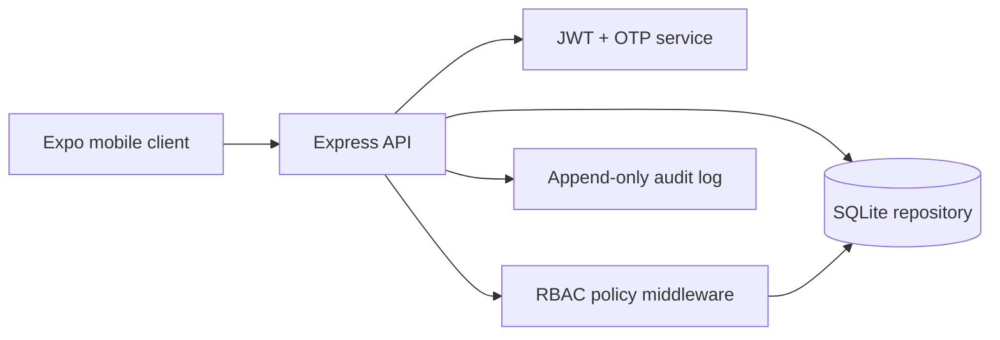

# SecureShift

SecureShift is a role-aware workforce scheduling service for teams that need auditable assignment and completion workflows. The reference implementation uses Express, TypeScript, Zod validation, JWT access tokens, scrypt password hashing, OTP challenges, and SQLite in WAL mode for a deterministic local environment. The persistence layer is deliberately isolated so a MongoDB adapter can be introduced without changing HTTP contracts.

## Architecture



## Structural overview

```text
src/
  app.ts       HTTP routes, validation, error boundary
  security.ts  password, JWT, OTP primitives
  db.ts        schema and connection bootstrap
  server.ts    process entrypoint
tests/         contract-level API tests
mobile/       client integration can be added without changing API contracts
```

## Workflow

1. A manager authenticates and receives a short-lived JWT.
2. The manager creates a shift; the API rejects malformed or overlapping time boundaries.
3. A manager assigns only a user with the `worker` role.
4. The assignee completes the shift, or a manager completes it on their behalf.
5. Every privileged mutation creates an audit event with actor, entity, and metadata.

## Security decisions

- Passwords use `scrypt` with a random per-user salt and constant-time verification. The JWT secret must be at least 32 characters in production.
- JWTs are issuer-scoped and expire after two hours.
- OTP codes are stored as SHA-256 digests and expire after five minutes.
- Role checks happen in middleware and ownership is checked again at the state transition boundary.
- The development response exposes `devCode` for local testing; it is disabled when `NODE_ENV=production`.

## Run locally

Requires Node.js 22.5 or newer because the local adapter uses the built-in `node:sqlite` module.

```bash
npm install
cp .env.example .env
npm run dev
# http://localhost:4010/health
npm test
```

## Trade-offs and next steps

SQLite keeps onboarding deterministic and makes the test suite self-contained. A production deployment should use MongoDB or PostgreSQL with migrations, a real SMS provider, refresh-token rotation, and an outbox-backed notification worker. The API intentionally keeps state transitions explicit so those changes do not alter client behavior.

## Production adapters

Set `DB_URL` or `SUPABASE_DB_URL` to select the managed Postgres connectivity check. Because the HTTP handlers still use the synchronous SQLite repository, production startup intentionally fails fast when these variables are present unless `POSTGRES_ROUTES_ENABLED=true`; the concrete remaining task is to migrate the route repository calls to an async Postgres implementation before enabling that flag. Set `SUPABASE_URL`, `SUPABASE_SERVICE_ROLE_KEY`, and `SUPABASE_STORAGE_BUCKET` (or `STORAGE_BUCKET`) for signed uploads. The service-role key is server-only and must never be placed in the Expo client. Local tests omit these values and continue using the Node SQLite adapter.
